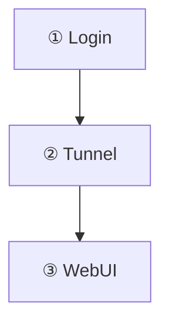

# Sigakhwa Click-to-Ask

Turns the boxes of a Mermaid diagram in an assistant reply into follow-up questions with confirmation, and adds
quick-ask buttons for text you select in a reply.

- **Click a box → review the full prepared question in a popover → Send** (same as typing it and pressing Enter), into the
  **same conversation and the same active profile**. The reply appears right below, usually as a more
  detailed diagram.
- **Select text in a reply → four buttons**: *쉽게 설명* (explain simply), *근거 확인* (check the evidence),
  *시각화* (visualize), *대안 비교* (compare alternatives). Pressing one sends a templated question that
  quotes the selection.

Only trusted clicks or focused Enter/Space confirmation send a box question. Reading or rendering a reply never sends anything.

It was built for the `sigakhwa` ("시각화", visualize) skill pattern — compress material into a 3–5 box
diagram, then drill into a box on demand — but works with any reply that carries the action block below.

## How a reply makes boxes clickable

Put a `sigakhwa-actions` block right after a ```` ```mermaid ```` flowchart in the same reply. Keys are the
Mermaid **node ids** of that flowchart:

````markdown


```sigakhwa-actions
{"v":1,"nodes":{"B":{"prompt":"Show the tunnel step as a more detailed diagram","label":"more detail"}}}
```
````

| Field | Rule |
|---|---|
| `v` | always `1` |
| `nodes` | object, up to 12 keys; each key `^[A-Za-z][A-Za-z0-9_-]{0,31}$` and an existing node id of the diagram |
| `prompt` | 1–500 characters; the exact question that is sent; must not start with `/` |
| `label` | optional, up to 20 characters (tooltip) |
| `diagram` | optional 0-based index when a reply has several Mermaid blocks (default: the one just before) |

Anything else (URLs, scripts, commands) does not exist in the schema and is ignored. A malformed block is
left as a normal code block. A valid block is collapsed into one line: *"클릭 가능한 상자 N개 · 상자를
누르면 보낼 질문을 확인한 뒤 전송할 수 있습니다"* with a *JSON 보기* toggle. Bound boxes get a dashed outline, a `?`
badge and a tooltip explaining that tapping opens a question preview. The popover shows the full prompt
as text, with Send and Cancel; Escape, outside clicks, or conversation/profile changes close it.

To make a model emit the block, add an instruction like the one above to the skill or system prompt that
produces diagrams (for example: "in WebUI, after the Mermaid block, add one `sigakhwa-actions` block with
one drill-down prompt per box").

## Safety rules of the send path

All sends go through one small module (`assets/shared/hermes-viz-send.js`, `window.HermesVizSend`) that
places the text in the composer and calls WebUI's own `send()` — the same path as pressing Enter.

- **Bound to the conversation it was rendered in.** Each box remembers the session id and profile at render
  time; a click after switching conversation or profile is refused ("이 그림은 다른 대화의 것입니다").
- **One click, one request.** The same question to the same conversation within 2 s is refused; a second
  send while one is in flight is refused.
- **Never during a running reply.** While a reply is streaming, a compression runs, the composer is locked
  or a message is being edited, the click is refused with a toast. This guard uses local state; Core may still queue a send if its server reports an active stream.
- **Clear your draft first.** Sends are refused while the composer contains text; drafts are never stashed or restored.
- **Only real user clicks.** Synthetic (script-generated) events are ignored; a drag over the diagram is a
  pan, not a click. Clicks elsewhere in the diagram keep WebUI's zoom/lightbox.

## Install

- **Gallery:** Settings → Extensions → Gallery → *Sigakhwa Click-to-Ask* → Install, then reload.
- **Manual:** copy this folder to `STATE_DIR/extensions/sigakhwa-click/` and add it to the install record, or
  serve it with `HERMES_WEBUI_EXTENSION_DIR` + a manifest (see WebUI `docs/EXTENSIONS.md`).

No WebUI restart is needed for a gallery install.

## Disable / uninstall

Settings → Extensions → Installed → toggle off (takes effect on reload) or Uninstall. The extension stores
nothing, so there is nothing to clean up.

## WebUI surfaces used

- Composer `#msg` and the global `send()` (the Enter path); core state `S` (`session.session_id`,
  `activeProfile`, `busy`, `activeStreamId`) to bind and guard sends.
- Transcript DOM: `.assistant-segment[data-msg-idx]`, Mermaid viewer (`.mermaid-rendered`,
  `svg.mermaid-viewer-svg`, `g.node`), fenced code `pre > code.language-sigakhwa-actions`.
- `showToast()` for refusals. One capture-phase document click listener and a MutationObserver scoped to
  `#msgInner`.
- Workaround: when two replies contain an identical Mermaid block, WebUI gives both the same render id and the
  second can fail to render on older Core. The fix was merged in nesquena/hermes-webui#8159 and shipped
  in exp-v0.52.460 (experimental); on older Core the extension re-renders a colliding diagram once
  through WebUI's own `renderMermaidBlocks()`. Genuinely invalid diagrams are left alone.

## Trust and permissions

Runs as trusted same-origin code with your WebUI session, like every extension. It **sends chat messages on
your behalf, only when you confirm Send** in a box popover or click a quick-ask button. No network calls of its own, no
storage, no sidecar, no external scripts.

## Known limitations

- Only Mermaid **flowcharts** have addressable node ids; blocks next to other diagram types stay plain code.
- The model must emit the action block; replies without it render as before.
- Messages are limited to 2000 characters; a selection is quoted up to 1000.

## Compatibility and verification

Core DOM surfaces were checked against Hermes WebUI `7a74ae1b` (October 2026), with Mermaid 10.9.3.
The registered regression suite loads both scripts in jsdom with a fake Core and covers the parser,
selection limits and whitespace performance, confirmation, trusted gestures, draft and binding guards,
and Korean/English locale changes:

```bash
node --test scripts/test-sigakhwa-click-review.mjs
```

For manual browser verification, tap a bound box on desktop and a 390px touch viewport: inspect the
full prompt, cancel, then reopen and confirm Send. Check that each confirmation sends once, that drafts
block sending, and that changing conversation/profile closes the preview. This revision was checked in
Chrome against Core `7a74ae1b` at 1280x860 and on a 390x844 touch viewport: a tap opens the preview and
sends nothing, Cancel sends nothing, a composer draft disables Send, and Send posts exactly one
`/api/chat/start` into the same session.

UI labels, refusal toasts, and quick-ask templates use Korean when the Core locale starts with `ko`,
and English otherwise. Core composer input events persist drafts via `/api/session/draft`, and Core
`send()` posts to `/api/chat/start`; both writes are declared in extension and manifest permissions.
